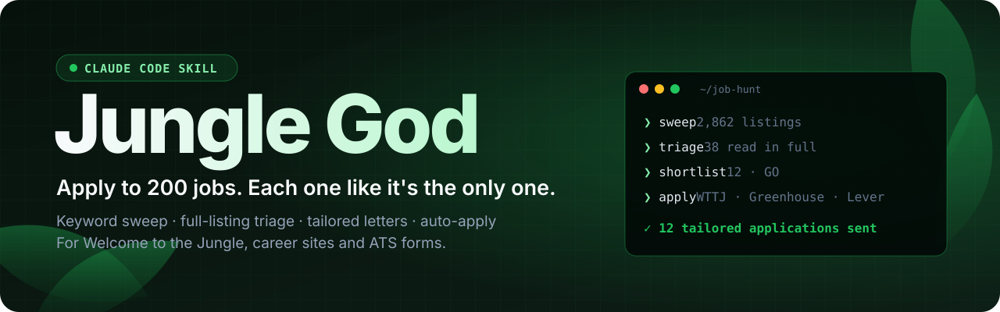

<p align="center">
  
</p>

<p align="center">
  <a href="README.md">English</a> · <b>Français</b>
</p>

# Jungle God

**Un skill Claude Code qui transforme ta recherche d'emploi en pipeline.**
Il balaye des centaines d'offres, garde celles qui te correspondent vraiment, écrit une lettre ciblée pour chacune
à partir de TES faits, remplit les formulaires sur n'importe quel site et ne postule jamais deux fois au même endroit.

> **Construit pendant une vraie recherche : plus de 200 candidatures ciblées en deux mois**, sur Welcome to the Jungle
> et sur les ATS et sites carrière derrière, dont une bonne partie sur des offres que je n'aurais jamais trouvées à la main.

## Installation

```bash
git clone https://github.com/theotlmd2-png/jungle-god ~/.claude/skills/jungle-god
```

Puis ouvre Claude Code et tape :

```text
/jungle-god go
```

C'est tout. Au premier lancement, il démarre l'onboarding et adapte tout à ton profil ; ensuite, la même
commande lance un nouveau lot. Claude te parle dans ta langue et écrit les lettres dans celle de chaque annonce.
Prérequis : [Claude Code](https://claude.com/claude-code), Python 3.11+, Google Chrome avec l'extension
[Claude in Chrome](https://claude.com/chrome). Ni compte WTTJ ni clé pour chercher.

## Pourquoi

| À la main | Avec Jungle God |
|---|---|
| 3 intitulés cherchés | 15 à 60 mots-clés par métier : outils, jargon, intitulés dans toutes les langues du marché |
| Tu lis le titre | Claude lit **la fiche en entier** et écarte celles qui ne collent pas à tes critères : expérience, diplôme, langue, lieu, rédhibitoires |
| Une lettre générique | Une lettre par offre : une preuve tirée de ton parcours pour chaque attente |
| « J'ai déjà postulé là-bas ? » | Liste noire automatique, alimentée par ton suivi WTTJ et chaque lot |
| 20 minutes par formulaire ATS | Claude remplit Greenhouse, Lever, Teamtailor, Workday… à partir de ton kit de candidature |
| Tu rafraîchis ta boîte mail | Une notification après chaque candidature, un tableau de bord après chaque lot |

## Comment ça marche

0. **Onboarding** (une seule fois) : Claude t'interviewe sur ton métier, ta zone, ton expérience réelle et tes
   preuves. Pas de CV ? Il t'en construit un. Il remplit ton **kit de candidature** (droit au travail, préavis,
   prétentions, « comment nous avez-vous connus »…) pour finir seul n'importe quel formulaire tiers. Puis il
   écrit une **lettre modèle sur une vraie offre** : tu la corriges, et toutes les suivantes partent de là.
1. **Balayage** : les pages métier publiques de WTTJ qui te correspondent (sans compte ni clé), filtrées
   par date, contrat, ville et titre, sans les entreprises déjà contactées.
2. **Tri** : lecture complète des fiches et critères durs. Mieux vaut 5 offres justes que 16 approximatives.
3. **Lettres** : écrites dans la foulée, une par offre, zéro invention, toutes les questions du formulaire préparées.
4. **Récap prêt-à-partir** : un seul message (CV ✓, lettres ✓, formulaires ✓, liste noire ✓) et le tableau
   des offres avec le pourquoi et le risque. Tu peux lire n'importe quelle lettre. **Rien ne part sans ton GO**,
   et après il va jusqu'au bout.
5. **Envoi** : WTTJ, ATS, sites carrière, autres jobboards. Après chaque candidature, une notification et une
   ligne qui te dit exactement ce qui a été fait, et où.
6. **Bilan** : envoyées, par site, ce qu'il te reste à finir, total cumulé. La liste noire est mise à jour.

## Il s'adapte à toi

Le pipeline est fixe, tes règles ne le sont pas (`rules.toml`, rempli avec toi à l'onboarding) : fourchette
d'expérience visée, diplômes, langues, rédhibitoires, lettre ou non, ton, canaux (WTTJ, sites carrière, Indeed, LinkedIn, candidatures
spontanées), qui clique sur « Envoyer », taille des lots, notifications.

Ce qui ne bouge jamais : **zéro invention**, pas d'envoi sans GO, jamais deux candidatures identiques dans
la même boîte, tes données restent sur ta machine.

## Au quotidien

```text
/jungle-god go
Nouveau lot : les offres des 7 derniers jours, max 10.
Montre-moi la lettre 3.
GO sauf la 4.
Envoie.
Change mes règles : plus d'offres en agence.
```

## Avertissements

- Projet indépendant, **sans lien avec Welcome to the Jungle**. Il utilise les mêmes requêtes de recherche
  publiques que le site, à faible cadence, pour un usage personnel. N'en fais pas un scraper de masse.
- Tu restes responsable de ce qui est envoyé en ton nom.

Le détail technique est dans le [README anglais](README.md) et dans [`SKILL.md`](SKILL.md).

## Licence

MIT
