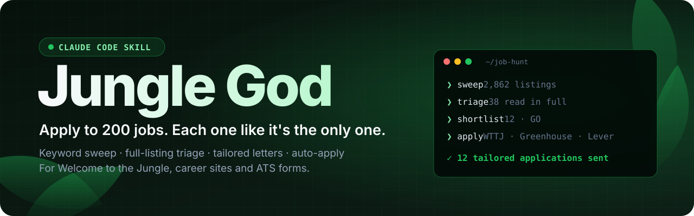

<p align="center">
  
</p>

<p align="center">
  <a href="https://claude.com/claude-code"></a>
  
  
  <a href="LICENSE"></a>
  <a href="README.fr.md"></a>
</p>

<p align="center">
  <b>A Claude Code skill that turns your job hunt into a pipeline.</b><br>
  It sweeps hundreds of listings, keeps the ones that truly fit, writes one tailored letter each<br>
  from <i>your</i> real facts, fills the forms on any site, and never applies twice to the same company.
</p>

<p align="center">
  <a href="#install">Install</a> ·
  <a href="#how-it-works">How it works</a> ·
  <a href="#it-adapts-to-you">It adapts to you</a> ·
  <a href="README.fr.md">Français</a>
</p>

---

> **Built during a real job hunt: 200+ targeted applications in two months**, on Welcome to the Jungle and
> the ATS and career sites behind it, many of them on listings I would never have found by hand.

## Install

```bash
git clone https://github.com/theotlmd2-png/jungle-god ~/.claude/skills/jungle-god
```

Then open Claude Code and type:

```text
/jungle-god go
```

That's it. On the first run it starts onboarding and adapts everything to you; after that, the same
command starts a new batch.
Requirements: [Claude Code](https://claude.com/claude-code), Python 3.11+, Google Chrome with the
[Claude in Chrome](https://claude.com/chrome) extension. No WTTJ account or API key needed to search.

## Why

Job hunting by hand means typing three job titles into a search bar, missing most of the listings
that fit you (because they are named differently), and rewriting the same cover letter at 11 pm.

| By hand | With Jungle God |
|---|---|
| 3 job titles searched | 15 to 60 keywords per target job: tools, jargon, titles in every language of your market |
| You skim the title | Claude reads the **whole listing** and drops the ones that miss your criteria: experience, degree, language, location, deal-breakers |
| One generic letter | One letter per listing: a proof from your background for each thing they expect |
| "Did I already apply there?" | Automatic blacklist, fed by your WTTJ tracker and every batch |
| 20 minutes per ATS form | Claude fills Greenhouse, Lever, Teamtailor, Workday… from your application kit |
| You refresh your inbox | A notification after each application, a scoreboard after each batch |

## How it works

```text
          ┌───────────────── first run only ─────────────────┐
          │ 0. Onboarding: situation → CV → proofs → kit     │
          │    → rules → approved model letter → criteria    │
          └────────────────────────┬─────────────────────────┘
                                   ▼
 1. Sweep ──▶ 2. Triage ──▶ 3. Letters ──▶ 4. Ready check ──▶ GO ──▶ 5. Apply ──▶ 6. Recap
 keywords     full read      table           you     one each        any site     scoreboard
     ▲                                                                                │
     └───────────────────── companies already contacted are excluded ◀────────────────┘
```

<details open>
<summary><b>0 · Onboarding</b>: it interviews you once</summary>

Target job, area, real experience, proofs (what you built and with what result), what must never be
written. No CV? It builds one. It collects your **application kit** (right to work, notice period,
salary answer, "how did you hear about us"…) so it can finish any third-party form without stopping.
Then it writes a **model letter on a real listing**; you correct it, and every later letter starts from it.
</details>

<details>
<summary><b>1 · Sweep</b>: hundreds of listings in seconds</summary>

Reads WTTJ's public job pages for your target jobs (no account, no key), filters by date, contract,
city and title, and removes companies you already contacted.
</details>

<details>
<summary><b>2 · Triage</b>: where the precision comes from</summary>

Reads the shortlisted listings in full (missions, profile wanted, process, salary, form questions) and applies
your hard criteria. Five right listings beat sixteen approximate ones.
</details>

<details>
<summary><b>3 · Letters</b>: one per listing, zero invention</summary>

Written straight after triage: one proof per expectation of the listing, the gap owned in one sentence,
every form question answered.
</details>

<details>
<summary><b>4 · Ready check</b>: one message, one GO</summary>

CV ✓, letters ✓, forms ✓, blacklist ✓, plus one table (company, role, salary, route, why it fits, risk).
Ask to read any letter. **Nothing leaves without your GO**, and after it, Claude goes all the way.
</details>

<details>
<summary><b>5 · Apply</b>: WTTJ, ATS, career pages, other boards</summary>

Claude fills the forms one by one in your Chrome, checks every field, and stops for passwords, CAPTCHAs or
any doubt. After each one: a desktop notification and one line telling you exactly what it did, and where.
</details>

<details>
<summary><b>6 · Recap</b>: the scoreboard</summary>

Sent, per site, left for you to finish, running total. Blacklist updated. Gmail replies read if connected.
</details>

## It adapts to you

The pipeline is fixed. Your rules are not. During onboarding, Claude writes `rules.toml` with you:

- the experience range you target, degrees, languages, deal-breakers, share of "stretch" listings;
- a letter for every listing, or CV only; tone and opening; banned phrases; projects never to mention;
- one CV per job family, or light tweaks per listing;
- channels: WTTJ only, or also career sites, Indeed, LinkedIn, spontaneous emails;
- who clicks Submit: Claude after your GO, you after Claude fills, or texts only;
- batch size, quotas per job family, notifications.

What never moves is the core: **zero invention** (nothing is written that is not in your profile), no submission
without GO, never the same application twice to one company, your data stays on your machine.

## Day to day

```text
/jungle-god go
New batch: listings from the last 7 days, max 10.
Show me letter 3.
GO except 4.
Apply.
Change my rules: no more agency roles.
```

## What's inside

```text
SKILL.md                 the brain: the pipeline Claude follows
references/
  onboarding.md          first-run interview, application kit
  cv.md                  CVs built during the conversation, one per target market
  setup.md               technical setup
  triage.md              hard criteria, shortlist format
  letters.md             writing method, form answers
  apply.md               filling forms in Chrome, mandatory stops, notifications, recap
  channels.md            ATS, career pages, other boards, spontaneous applications
scripts/                 stdlib Python, zero dependency
  sweep.py               keyless sweep of WTTJ's public job pages
  search.py              optional fast keyword search (your own key)
  details.py             full listings and form questions
  blacklist.py           companies already contacted
  review.py              batch scoreboard and letters as HTML
  notify.py              desktop notification after each application
  cv_pdf.py              HTML CV or letter → A4 PDF
templates/               profile, rules, criteria, CV, applications format
tests/                   unit tests (pytest)
```

Your files (`profile.md`, `rules.toml`, `criteria.toml`, `cv/`, `applications/`) live in your own working
folder, outside the skill, and are git-ignored.

## Lessons learned the hard way

- **Rejections within 48 hours are CV screens.** If they pile up, fix the CV, not the letters.
- **Broad keywords beat job titles.** The tools and jargon of your field surface roles that are never named the way you think.
- **Title triage is not enough.** The real requirements hide in the body of the listing, not in the badge.
- **One form at a time.** Several agents filling forms in parallel means mixed tabs and double submissions.
- **WTTJ forms have two file inputs**: photo first, CV second. Target the right one.

## Disclaimer

- Independent project, **not affiliated with Welcome to the Jungle**. It uses the same public search requests as
  the website, at a low pace, for personal use. Respect the terms of the sites you use; do not turn it into a mass scraper.
- You remain responsible for what is sent in your name. Review the shortlist and the letters.
- Sites change. If a search or a form breaks, open an issue.

## License

MIT

<p align="center">
  <a href="https://star-history.com/#theotlmd2-png/jungle-god&Date">
    
  </a>
</p>
